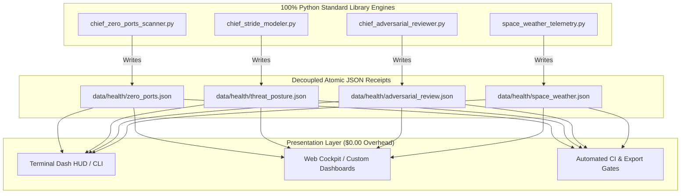

# Sovereign Security Tools 🛡️

A lightweight, zero-dependency, local-first security toolkit built for sovereign developers, AI coding agents, and homelab defense.

> *"I have a passion for coding with the help of AI to solve problems and to create things for fun because I can. To make that work at scale, AI agents need solid engineering foundations, deep documentation, and rigorous boundaries."*  
> — **Ethan (TWU LLC)**

This repository provides single-purpose, hardened defensive tools that anyone can run on their machine in seconds without paying for cloud subscriptions or installing heavy packages.

[](https://github.com/Ethan-da-Tech-Wizard/sovereign-security-tools/actions)
[](LICENSE)
[](https://docs.python.org/3/)
[](MAGI_BIBLE.md)

---

## Architecture: Decoupled Telemetry & State Separation



---

## Visual Walkthrough & CLI Execution Previews

### 1. Zero Open Ports Perimeter Auditor (`chief_zero_ports_scanner.py`)
Scans network sockets with strict connection timeouts (0.2s) to guarantee zero unauthenticated public listening ports.

```text
======================================================================
 🛡️  CHIEF ZERO PORTS PERIMETER AUDITOR (ChiefGyk3D / Apache-2.0)
======================================================================
 Target Host:       127.0.0.1
 Total Probed:      27 ports
 Open Ports:        []
 Unauthorized Open: []
 Filtered (Silent): 0
 Perimeter Clean:   ✅ PASS (Zero Exposure)
======================================================================
```
* **Command:** `python3 scripts/chief_zero_ports_scanner.py --target 127.0.0.1`
* **Receipt Output:** `data/health/zero_ports.json`

---

### 2. STRIDE & MITRE ATLAS Threat Modeler (`chief_stride_modeler.py`)
Generates deterministic STRIDE and MITRE ATLAS threat matrices tailored for AI agent execution lanes and sovereign workflows.

```text
======================================================================
 🛡️  CHIEF STRIDE & ATLAS THREAT MODELER (ChiefGyk3D / Apache-2.0)
======================================================================
 Target System:      TWU-Sovereign-Fleet
 Total Components:   5
 Identified Threats: 11
----------------------------------------------------------------------
 [STRIDE] Tampering (T) -> Fleet OS Portal Dashboard
   Severity:   HIGH
   Mitigation: Apply SHA-256 tree hashing, file lock sentinels, and read-only jail environments.

 [MITRE ATLAS] Adversarial Prompt Injection (AML.T0051) -> Autonomous Coding Subagent Engine
   Severity:   HIGH
   Mitigation: Enforce strict tool guardrails, input sanitization sieves, and stop latches.
======================================================================
```
* **Command:** `python3 scripts/chief_stride_modeler.py`
* **Receipt Output:** `data/health/threat_posture.json`

---

### 3. Adversarial Code Reviewer (`chief_adversarial_reviewer.py`)
*"The best thing a second agent can do for the first one is disagree with it."*  
Audits codebases for bare `except:` catch blocks, missing `timeout` arguments in subprocesses, `shell=True` hazards, and Rule 16 comment density ($\ge 25\%$).

```text
========================================================================
 ⚔️  CHIEF ADVERSARIAL CODE REVIEWER (ChiefGyk3D / Apache-2.0)
========================================================================
 Fleet Review Verdict: ✅ PASS
 Total Files Audited:  4 files
 Passing Files:        4
 Warnings:             0
 Failed Gates:         0
 Average Health Score: 100.0 / 100
 Average Density:      36.8% (Rule 16 requires >= 25%)
========================================================================
```
* **Command:** `python3 scripts/chief_adversarial_reviewer.py scripts/`
* **Receipt Output:** `data/health/adversarial_review.json`

---

### 4. NOAA Space Weather Telemetry Collector (`space_weather_telemetry.py`)
Collects live planetary geomagnetic storm conditions (Kp index), solar radiation flux, and high-frequency radio blackouts from the NOAA SWPC.

```text
======================================================================
 🛰️  NOAA SPACE WEATHER & GEOMAGNETIC TELEMETRY COLLECTOR
======================================================================
 Timestamp:          2026-11-21T17:10:00Z
 Geomagnetic Storm:  G0 (Quiet - Kp Scale Normal)
 Solar Radiation:    S0 (Nominal Flux)
 Radio Blackout:     R0 (HF Propagation Clear)
 Operating Status:   LIVE (SWPC Active)
======================================================================
```
* **Command:** `python3 scripts/space_weather_telemetry.py`
* **Receipt Output:** `data/health/space_weather.json`

---

## The AI Agent Engineering Standard

Interested in how human builders and AI agents collaborate without generating chaotic legacy code? Read our open-source standard:

👉 **[The Magi Bible: Open-Source AI Agent Engineering & Collaboration Standard](MAGI_BIBLE.md)**

Covers:
* **Rule 16:** Why $\ge 25\%$ comment density and 4-line headers prevent AI code rot.
* **Standard Library Invariants:** How to maintain zero dependencies and $0.00 spend.
* **Adversarial Multi-Agent Friction:** Why separating implementers from reviewers creates bulletproof systems.
* **Zero PII & Secret Auditing:** How automated pre-export gates protect developers from accidental leaks.

---

## Running the Unit Tests

Every module is covered by rigorous regression tests:
```bash
python3 -m unittest discover -s tests -v
```

---

## License & Attribution

Licensed under the **[Apache License 2.0](LICENSE)**.  
See **[NOTICE](NOTICE)** for upstream attributions to [ChiefGyk3D](https://github.com/ChiefGyk3D) and the National Oceanic and Atmospheric Administration (NOAA).
